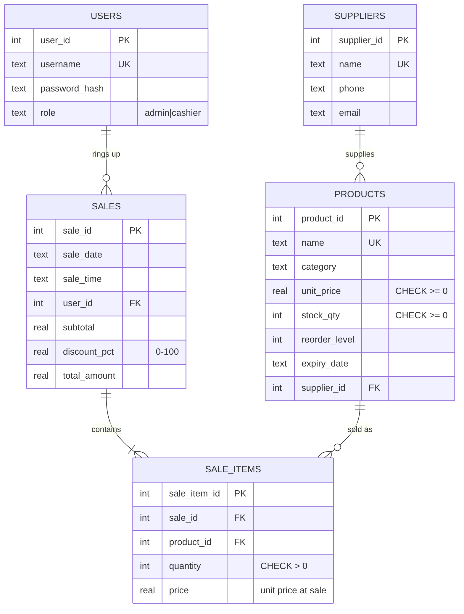
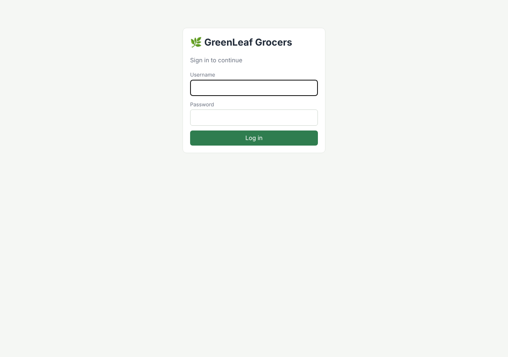
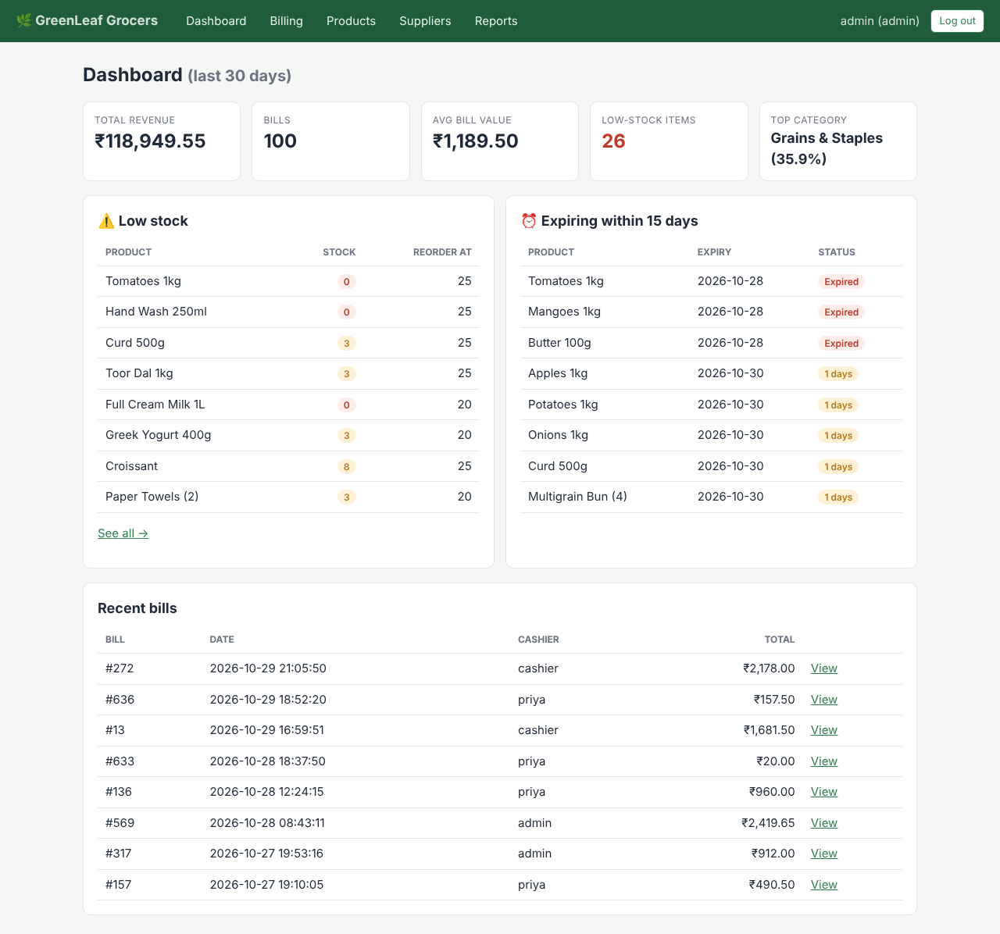
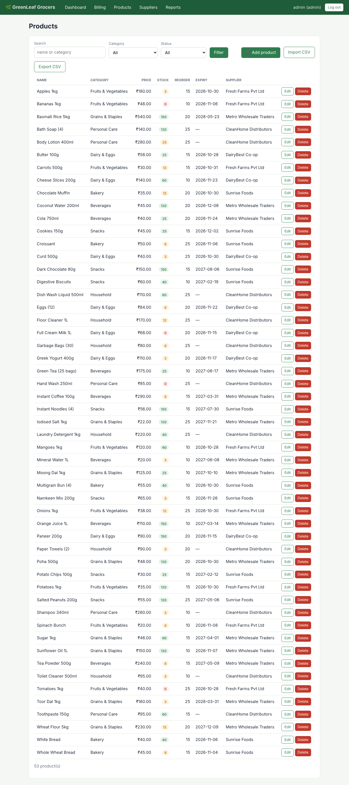
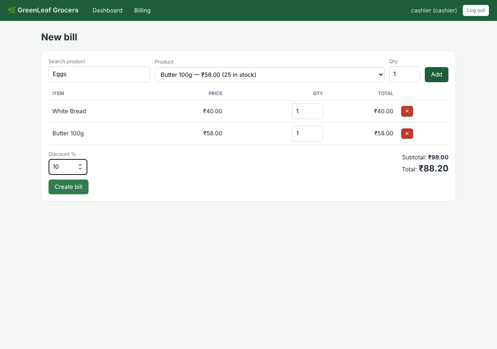
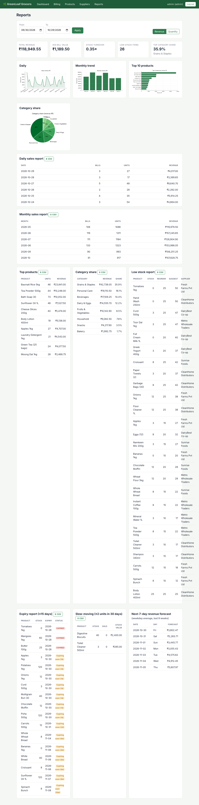
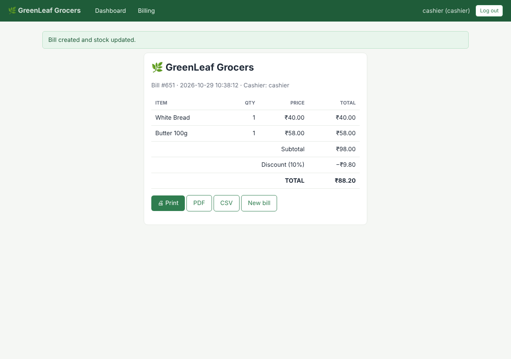

# 🌿 GreenLeaf Grocers – Inventory & Sales Management System

A Flask + SQLite web app for managing products, stock, billing and sales analytics (pandas + matplotlib).

## Features
- **Role-based login** – *admin* (products, suppliers, reports) and *cashier* (billing only); passwords hashed with `werkzeug.security`; CSRF protection on all forms.
- **Product management** – add / edit / delete, search, filter by category or status (low stock, out of stock, expiring ≤ 15 days).
- **CSV import / export** – row-by-row validation, bad rows skipped and reported; existing products (same name) are updated.
- **Billing** – multi-item bills, discount %, automatic stock deduction inside one transaction (all-or-nothing), receipt as print / **PDF** / **CSV**.
- **Validation** – negative or non-numeric quantities, invalid dates, discounts outside 0–100 %, selling more than available stock → friendly messages, never a crash.
- **Alerts** – low-stock and near-expiry panels on the admin dashboard.
- **Reports** (date-range selector, CSV export for each): daily, monthly, top products, category share, low stock, expiry, slow-moving, plus a 7-day revenue forecast (bonus). Charts can be switched between **Revenue** and **Quantity**.
- **KPIs** – total revenue, average bill value, stock turnover, low-stock count, top-category share.

## Quick start
```bash
python -m venv venv && source venv/bin/activate      # Windows: venv\Scripts\activate
pip install -r requirements.txt
python seed_data.py        # creates data/greenleaf.db: 53 products, 650 sales over 6 months
python run.py              # open http://127.0.0.1:5000
```
| Role | Username | Password |
|---|---|---|
| Admin | `admin` | `admin123` |
| Cashier | `cashier` | `cashier123` |

Run tests: `python -m pytest -v` (uses a temporary database; never touches your data).
Docker: `docker build -t greenleaf . && docker run -p 8000:8000 greenleaf`
Set `SECRET_KEY` in the environment for any real deployment.

## Project layout
```
app/
  __init__.py     app factory, CSRF check, error pages
  database.py     sqlite connection + schema init      schema.sql  tables, constraints, indexes
  models.py       users, suppliers, products, CSV import, create_bill()
  reports.py      pandas analytics, KPIs, matplotlib charts
  utils.py        validators, auth decorators
  routes/         auth (login, dashboard) · products · billing · reports
  templates/ static/
seed_data.py      sample-data generator (seeded RNG)
tests/            29 pytest tests
docs/             ER diagram, test report, project report, screenshots
```

## Database


3NF: product → supplier and sale → items are separate tables; `sale_items.price` stores the unit price *at time of sale* so later price changes don't rewrite history. CHECK constraints enforce non-negative prices/stock, positive quantities and valid roles; foreign keys are enforced (`PRAGMA foreign_keys=ON`).

## Metric definitions
- **Revenue** = sum of bill totals (after discount). Product/category revenue apportions the bill discount across lines.
- **Average bill** = revenue ÷ bills.
- **Stock turnover** = units sold ÷ average inventory units, where opening stock = current stock + units sold in the period.
- **Slow-moving** = in stock, ≤ 2 units sold in the last 30 days.
- **Top category share** = best category revenue ÷ total revenue.

## Screenshots
| | |
|---|---|
|  |  |
|  |  |
|  |  |

See also `docs/PROJECT_REPORT.md` and `docs/test_report.txt`.
